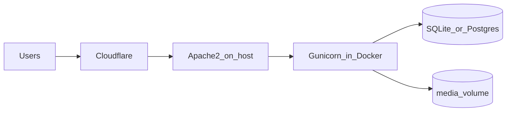

# Docker + host Apache2 + Cloudflare deployment

## Architecture

- **Cloudflare**: terminates visitor TLS (orange-cloud proxy). Origin can use HTTPS with a real cert (recommended) or HTTP only if you accept weaker setups (not recommended).
- **Apache (host)**: listens on 80/443, reverse-proxies to the app. Bind Gunicorn to **127.0.0.1:8000** so it is not exposed publicly.
- **Docker**: runs **Gunicorn** serving `[Django-Back-Front/config/wsgi.py](Django-Back-Front/config/wsgi.py)`. The image must include **both** `[Django-Back-Front/](Django-Back-Front/)` and `[Solver-Side/](Solver-Side/)` at the same relative paths as today, because `[Django-Back-Front/pos/solver_bridge.py](Django-Back-Front/pos/solver_bridge.py)` resolves the solver as `BASE_DIR.parent / "Solver-Side" / "Main-Solver" / "CP-SAT.py"`.

## Gaps to fix before production

| Area            | Current state                                                                                                                                    | Deployment action                                                                                                                                                                                                               |
| --------------- | ------------------------------------------------------------------------------------------------------------------------------------------------ | ------------------------------------------------------------------------------------------------------------------------------------------------------------------------------------------------------------------------------- |
| Solver deps     | `[Django-Back-Front/requirements.txt](Django-Back-Front/requirements.txt)` has no `ortools`                                                      | Add `ortools` (and any other missing imports from the solver stack) to requirements or a dedicated `requirements-prod.txt`.                                                                                                     |
| Django settings | `[Django-Back-Front/config/settings.py](Django-Back-Front/config/settings.py)`: `DEBUG=True`, hardcoded `SECRET_KEY`, permissive `ALLOWED_HOSTS` | Use environment variables: `DEBUG`, `SECRET_KEY`, `ALLOWED_HOSTS`, `CSRF_TRUSTED_ORIGINS` (your `https://yourdomain`), and behind a proxy: `SECURE_PROXY_SSL_HEADER`, `USE_X_FORWARDED_HOST` (see Django deployment checklist). |
| Static files    | `STATIC_ROOT` set                                                                                                                                | Run `collectstatic` in image build or container entrypoint; Apache can serve `/static/` via `Alias` or use WhiteNoise middleware (simpler single-path).                                                                         |
| Media           | `MEDIA_ROOT` under project                                                                                                                       | Persist a **host volume** or named volume for `media/` and SQLite if you keep SQLite.                                                                                                                                           |

## Docker image (recommended layout)

- Add a `**Dockerfile`** at repo root (or under `Django-Back-Front/` with build context `..` so Solver-Side is included).
- **Base image**: `python:3.12-slim` (or match your local Python).
- **System packages**: minimal set for your stack (e.g. `libpq-dev` if Postgres later; graphics/OCR libs if EasyOCR/pdf2image need them on Linux—mirror what you need from current dev machine).
- **Install**: `pip install -r Django-Back-Front/requirements.txt` (+ `gunicorn`, `ortools`).
- **Working directory**: set to `Django-Back-Front` or set `WORKDIR` so `manage.py` and `config` import cleanly.
- **Command**: `gunicorn config.wsgi:application --bind 127.0.0.1:8000` is wrong *inside* container if Apache is on host—bind `0.0.0.0:8000` **inside** the container and publish only to host loopback via Compose: `ports: ["127.0.0.1:8000:8000"]`.

Optional: `**docker-compose.yml`** with one service `web`, env file `.env`, and volumes for `db.sqlite3` + `media`.

## Host Apache2 (reverse proxy)

Enable modules: `proxy`, `proxy_http`, `headers` (and `ssl` for origin HTTPS).

Example pattern (HTTP to container; TLS at Cloudflare only is possible but weaker):

- `ProxyPreserveHost On`
- `RequestHeader set X-Forwarded-Proto "https"` if users always hit Cloudflare HTTPS (so Django knows requests are secure)
- `ProxyPass / http://127.0.0.1:8000/`
- `ProxyPassReverse / http://127.0.0.1:8000/`

For **Full (strict)** at Cloudflare, install a certificate on Apache (e.g. Certbot) and listen on 443.

## Cloudflare (DNS + SSL)

- Create an **A** record pointing to the VPS public IP, **proxied** (orange cloud).
- **SSL/TLS** mode: prefer **Full (strict)** with a valid origin cert on Apache; otherwise **Full** with any origin cert.
- Set **CSRF_TRUSTED_ORIGINS** in Django to `https://your.domain`.
- Optional: restrict origin to Cloudflare IPs in Apache `Require ip` if you only want Cloudflare-facing traffic (advanced).

## Operational checklist

- Run migrations: `docker compose exec web python manage.py migrate`
- Create superuser if needed.
- Set strong `SECRET_KEY` and never commit it.
- Back up SQLite file or switch to PostgreSQL for concurrent durability (future improvement).

## What we will not assume

- Exact VPS OS (Ubuntu/Debian commands differ slightly); the plan uses standard Apache + Docker patterns you can adapt.

